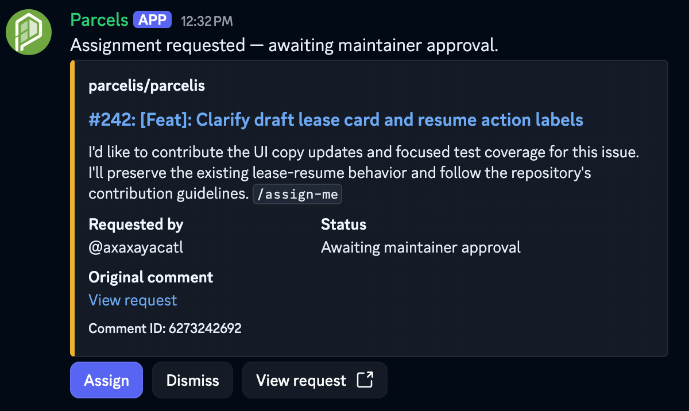
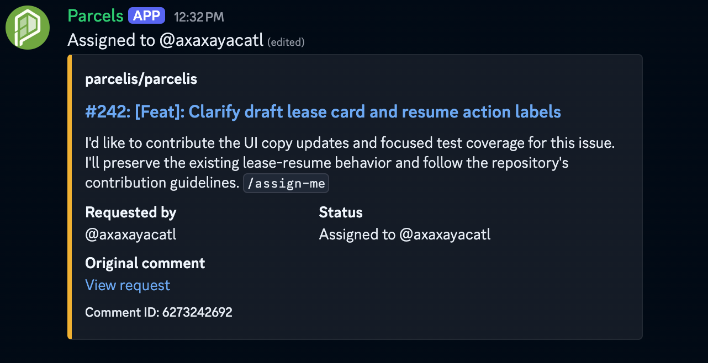
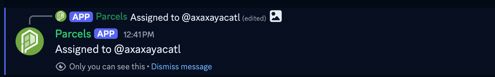
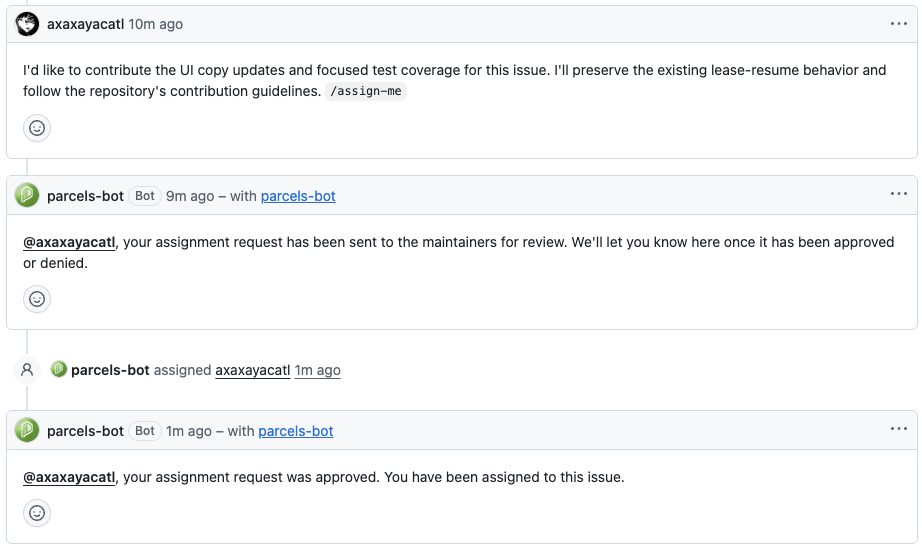
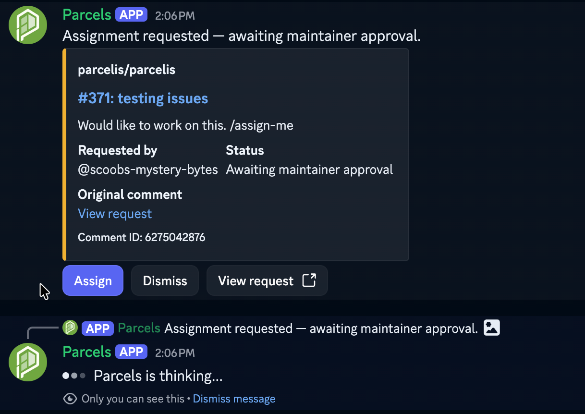
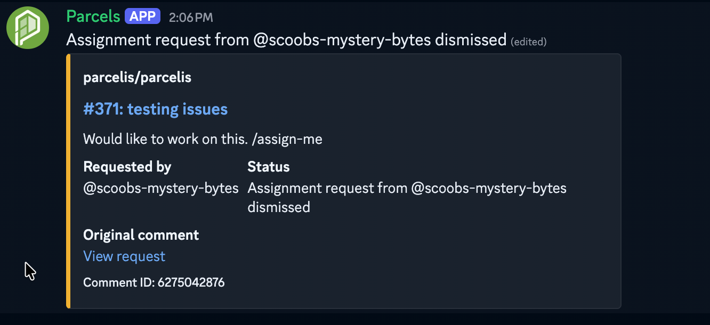
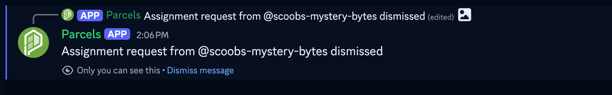
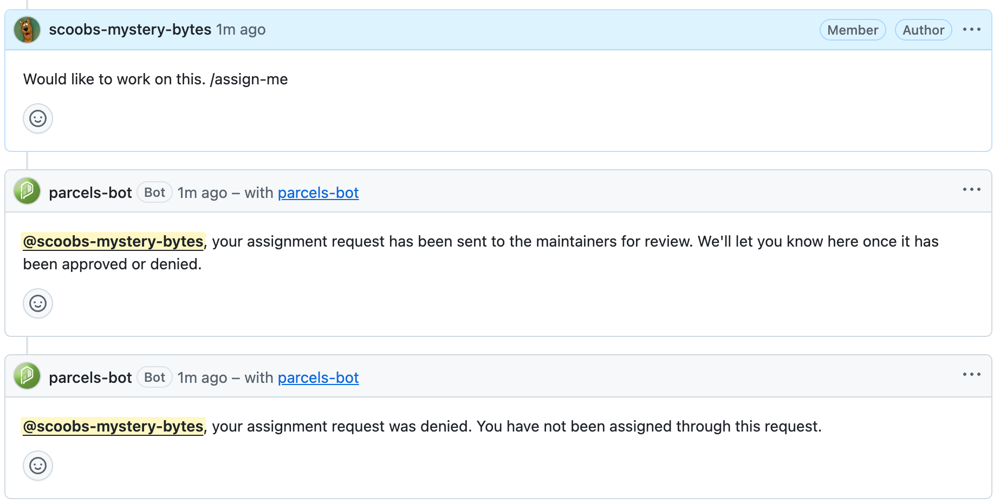

# Issue assignment approvals: GitHub + Discord demo

A contributor requests an issue assignment on GitHub. A maintainer reviews the request in Discord, and the contributor receives the decision back on the GitHub issue.

This walkthrough demonstrates the approval and denial flows using [Assign Issue Action Automation Approvals](https://github.com/marketplace/actions/assign-issue-action-automation-approvals). See the Marketplace listing for installation and configuration.

## How it works

1. A contributor posts an issue comment containing `/assign-me`.
2. The bot acknowledges the request on GitHub and sends it to Discord for maintainer review.
3. A maintainer selects **Assign** or **Dismiss** in Discord.
4. The Discord card updates, and the bot posts the outcome on GitHub.

| Discord action | GitHub outcome |
| --- | --- |
| **Assign** | The contributor is assigned to the issue and receives an approval comment. |
| **Dismiss** | The contributor receives a denial comment and is not assigned through that request. |
| **View request** | Opens the original request for review. |

> **Dismiss means deny the assignment request.** It is different from the **Dismiss message** link shown on Discord's private confirmation messages.

## Approval walkthrough

### 1. Request an assignment

A contributor comments on a GitHub issue with a description of the work they want to take on and `/assign-me`:

```text
I'd like to contribute the UI copy updates and focused test coverage for this issue.
I'll preserve the existing lease-resume behavior and follow the repository's
contribution guidelines. /assign-me
```

The bot replies on the issue to confirm that the request has been sent to the maintainers for review.

### 2. Review the request in Discord

The Discord card shows the repository, issue, contributor's comment, requester, and current status: **Awaiting maintainer approval**. The maintainer can select **View request** to open the original comment.



### 3. Select Assign

The maintainer selects **Assign**. Discord displays a private confirmation, and the request card updates to **Assigned to @axaxayacatl**. The action buttons are no longer shown on the completed card.



<details>
<summary>View the maintainer's private confirmation</summary>



</details>

### 4. Confirm the outcome on GitHub

The GitHub issue timeline records the assignment. The bot also posts a comment confirming that the request was approved and the contributor has been assigned.



## Denial walkthrough

### 1. Request an assignment

A contributor posts another assignment request:

```text
Would like to work on this. /assign-me
```

The bot acknowledges the request on GitHub and sends it to Discord for review.

### 2. Review the request in Discord

The request appears with the status **Awaiting maintainer approval** and the same **Assign**, **Dismiss**, and **View request** controls.



### 3. Select Dismiss

The maintainer selects **Dismiss** to deny the assignment request. Discord displays a private confirmation, and the card updates to show that the request from **@scoobs-mystery-bytes** was dismissed. The action buttons are no longer shown on the completed card.



<details>
<summary>View the maintainer's private confirmation</summary>



</details>

### 4. Confirm the outcome on GitHub

The bot posts a denial comment on the original issue, telling the contributor that they have not been assigned through this request.



## Try the demo

With the integration configured:

1. Post a comment containing `/assign-me` on a test issue.
2. Open the resulting Discord request and select **Assign**.
3. Confirm that the Discord card updates and GitHub shows the assignment and approval comment.
4. Post another assignment request on a separate test issue.
5. Select **Dismiss** on its Discord card.
6. Confirm that the card shows the request as dismissed and GitHub receives a denial comment, with no assignment through that request.

The screenshots show the Parcels deployment in `parcelis/parcelis`: issue **#242** for approval and issue **#371** for denial.
